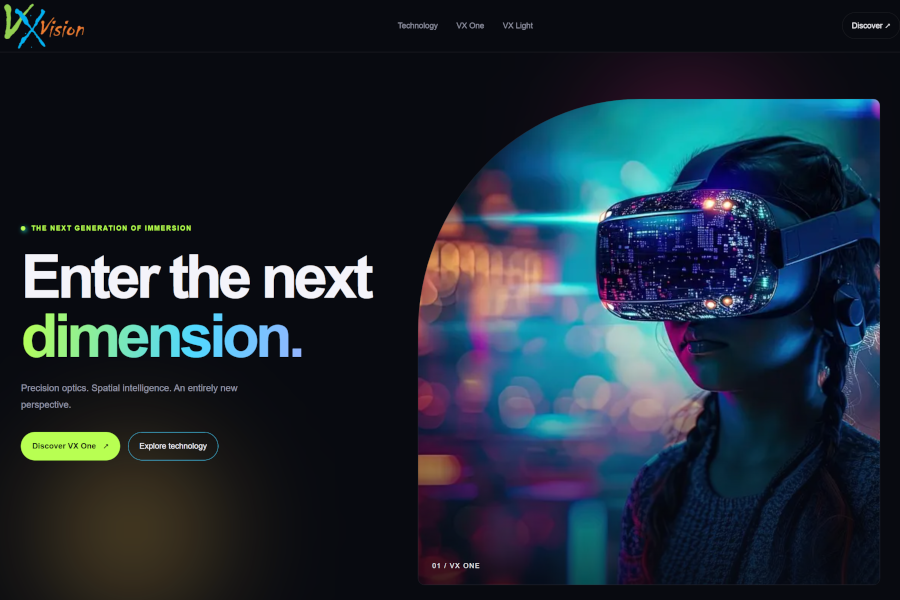

# VX Vision (showcase project)

Next.js 16 · TypeScript · Tailwind CSS v4 · Webpack (no Turbopack in build)

## About

A dark, demo page with neon color highlights for a fictional VR goggle company. The project has been focused on various CSS techniques that bring the page to life through the use of bold colors and a range of small details, such as delayed text appearances and other animations.

## Run

    npm install
    npm run dev      # next dev
    npm run build    # next build --webpack
    npm start

## Images (Pixabay CDN)

All image paths live in `src/data/site.ts` and `src/data/products.ts`.

The design uses CDN images with a medium resolution. To change the images, simply replace the url links in the data files.

If you use own photos, then add them into the public folder and point the image/src link to that
location.

## Structure

- `src/data/` typed static content;
- `src/lib/products.ts` data access layer
- `src/components/ui/` reusable primitives (Blob, Button, CdnImage, ImageSlider, PaintUnderline, SectionHeading)
- `src/components/motion/` ShaderBackground (Paper Shaders), ScrollParallax (GSAP), PhysicsPlayground (Matter.js)
- `src/components/layout/` Header, Footer, Providers, SmoothScroll (Lenis)
- `src/components/sections/` page sections; `src/app/` routes (/, /programs, /contact, /api/contact)
